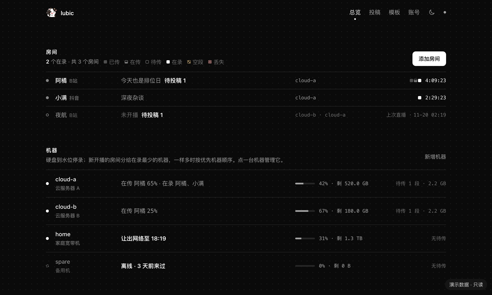
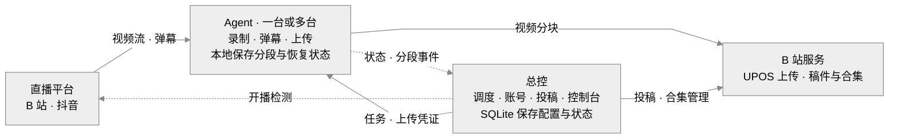

<p align="center">
  
</p>

<h1 align="center">lubic</h1>

<p align="center">多机协作的 B 站 / 抖音直播录制与自动投稿</p>

<p align="center">
  
  
</p>

lubic 从 [biliup](https://github.com/biliup/biliup) 提炼而来，目标是一个**最小、稳定**的录制器：轮询开播 → 录制 HTTP-FLV / HLS → 按时长或大小切段 → 断流自动重连 → 下播宽限期满回到轮询。在此之上，它把录制、上传、投稿拆成「总控 + 多台 Agent」：一台机器录不好（CDN 限速、断流、磁盘满、上行被占），总控把房间换到另一台，计划内的交接会让两台重叠录一段以减少缺段；各台录的分段最后集中投成一份稿件。

> 这是作者自用项目的公开快照，用来分享技术栈与设计思路。源码与自用版同步，作者自己的部署脚本与基础设施不包含在内；仓库 CI 会构建 Docker 镜像，不另发版本。

### 术语

| 术语 | 含义 |
|---|---|
| 总控（controller） | 唯一的调度中心：开播检测、给房间分配机器、签发上传凭证、投稿、提供控制台 |
| Agent | 每台录制机上跑一个：录制总控分来的房间、上传分段、上报状态 |
| 受限 | 总控判定某台机器录不好或传不动（录制倍率低、时间戳频繁跳变、上传跟不上产出），暂时不再给它分房间 |
| 交接 | 把在录的房间从一台机器换到另一台：新机先开录，两台重叠到切点后旧机收尾 |
| 让出网络 | 手动让某台机器在一段时间内暂停上传、尽量不录，到点自动恢复 |
| 排空 | 滚动更新时把某台 Agent 上的房间迁走，空了再更新它 |

## 特性

- **录制**：B 站、抖音开播检测与选流；HTTP-FLV / HLS 拉流；FLV 时间戳重基、按关键帧切段；停顿看门狗、断流重连、下播宽限。
- **弹幕**：B 站 TCP 弹幕、抖音匿名轮询，每个分P生成同名 B 站格式 XML。
- **多机调度**：开播按负载分给在录最少的机器；录制异常时先让另一台交叉试拉，确认是这台机器的问题才判受限；上传长期跟不上产出直接判受限；受限、排空、让出网络的机器上的房间会对准切点交接走；Agent 失联则直接改派（这种情况中间可能缺一段）。
- **让出网络**：某台机器所在网络需要带宽时（比如家里有人要打游戏），可让它暂停上传、只在别无选择时兜底录制，到点自动恢复。
- **上传**：直传 B 站 UPOS，分块并发、指数退避、断点续传，可边录边传。
- **投稿**：扫码登录、令牌自动刷新；按场次聚合多台机器录的分段，模板化标题，自动生成封面、加入合集。
- **离线容错**：总控离线时 Agent 照最后一份清单继续录，上传与事件排队，总控回来后补传。
- **管理控制台**：内置 Web 控制台，管理房间、模板、账号、机器，查看录制与投稿状态。

## 控制台预览



[在线演示](https://dplei.github.io/lubic-oss/docs/demo/)：用真实的控制台页面加上虚构数据，不连总控，只能浏览、改动不会保存。演示页由 `tools/console-demo.sh docs/demo` 生成，数据定义在 `crates/controller/src/demo.rs`。

## 技术栈

| 方面 | 选型 |
|---|---|
| 语言 | Rust 2024 edition，`tokio` 异步运行时 |
| HTTP | `reqwest`（客户端）、`axum`（总控服务端） |
| 存储 | SQLite（`rusqlite`，bundled），总控唯一的状态来源 |
| 媒体 | 手写 FLV 解析（`nom`）、`m3u8-rs` |
| 通信 | 总控 ↔ Agent 走 HTTP 长轮询 + JSON，Agent 主动连出，NAT 后的机器也能接 |
| 控制台 | 单文件 HTML，内嵌在总控二进制里 |
| 交付 | 单个 Docker 镜像同时包含总控与 Agent |

## 架构

总控负责调度与投稿，Agent 负责本机录制与上传。单机部署也是同一套分工：同机运行一个总控和一个 Agent；多机部署时由总控统一分配房间。



投稿账号凭证只留在总控；Agent 可另配录制用的 cookie，上传时只拿到总控为单个文件签发的上传凭证。视频上传并经总控确认后才删本地，弹幕 XML 保留在 Agent 本地。

### 设计原则

- **积木式分层**：录制与上传只通过 `lubic-events` 的分段事件衔接，互不 import；总控与 Agent 只通过 `lubic-proto` 的 HTTP 消息通信。
- **机制在核心，触发在外部**：像「让出网络」这类需求，核心只提供通用机制（暂停上传、降档、不当交接目标），什么时候打开由控制台或外部脚本经 HTTP API 决定。
- **宁可多录，不可漏录**：所有候选机都受限、在排空、在让出时，仍会兜底分配。计划内交接时新旧两台重叠录制，确认新机已录到旧机的进度之后旧机才收尾：抖音流里有推流端 NTP 时刻时据此比较，没有时按两台的延迟估算；旧机已经录不出内容时直接放行。
- **结果未知不重试**：投稿超时或崩溃在提交中，稿件标为待人工确认，绝不自动重投。

### Workspace

| crate | 职责 |
|---|---|
| `lubic`（根目录） | 录制器库与独立命令行；设了 `RecordConfig::events` 时把分段事件发进 channel |
| `crates/events`（`lubic-events`） | 录制与上传之间唯一共享的事件契约 |
| `crates/upos`（`lubic-upos`） | 把文件传上 B 站 UPOS，只传字节，不懂登录 |
| `crates/account`（`lubic-account`） | 扫码登录、令牌刷新、preupload、投稿；管理投稿账号的登录凭证，只被总控使用 |
| `crates/proto`（`lubic-proto`） | Agent 与总控之间的 HTTP 消息 |
| `crates/controller`（`lubic-controller`） | 总控：开播检测、分配与交接、上传凭证、集中投稿、控制台 |
| `crates/agent`（`lubic-agent`） | Agent：录总控派来的房间 → 逐段要凭证上传 → 报文件名 → 总控确认后删本地 |

## 部署

lubic 由两部分组成：**总控**（管理网页、调度、投稿）和**录制程序 Agent**（拉流、录像、上传）。按你打算把它放在哪里，选下面一种场景。

选之前先算一下带宽：每录一个房间，大约同时占用 **10 Mbps 下行（拉直播流）+ 10 Mbps 上行（边录边传到 B 站）**，每小时约 4～5 GB；同时录几个房间就乘几倍。

> **推荐让 AI 帮你装。** 把下面这句话发给你的 AI 编程助手（Claude Code、Codex、Cursor 等）。它会先问清你的情况、检查电脑环境、生成配置，每一步执行前都先征得你同意；只有输入密码、扫码登录这类事需要你亲手做。
>
> ```text
> 克隆 https://github.com/dplei/lubic-oss ，按其中 skills/lubic-deploy/SKILL.md 的流程帮我部署 lubic。
> ```

### 在自己的电脑上（Windows / Mac）

适合想先试一试、只录一两个房间，或者电脑本来就常开的人。

- **Windows**：装好 Docker Desktop，下载现成的程序镜像，一份配置文件同时跑起总控和录制。
- **Mac**：不用装 Docker，从源码编译出两个小程序，交给系统开机自启。
- **怎么用**：浏览器打开 `http://127.0.0.1:7070` 的管理网页，扫码登录 B 站账号、添加直播间。之后开播自动录、下播自动投稿。

**优点**：不花钱；家庭宽带下行通常很宽，拉流稳定；录像就在自己硬盘上。

**缺点**：电脑关机或睡眠就停录，要关掉自动睡眠；家里上行一般只有 30～50 Mbps，录一路就占掉 10 Mbps，家里人打游戏、视频通话会变卡，录像上传也会变慢（可以在管理网页里临时「让出网络」）；Windows 上 Docker Desktop 本身要占 2 GB 左右内存。

### 在云服务器上

适合要 7×24 小时不漏录，或者同时录的房间比较多的人。

- **怎么装**：在 Linux 服务器上装 Docker，下载现成的程序镜像，一份配置文件跑起总控和录制。
- **怎么用**：有域名的话，加一个自动配置 HTTPS 的 Caddy，在任何地方都能用浏览器打开管理网页；没有域名，就只对服务器本机开放，在自己电脑上通过 SSH 隧道打开。

**优点**：7×24 小时不关机；机房上下行对称，上传快；完全不占家里的网。

**缺点**：要花钱；国内云服务器多按带宽峰值收费，同时录 3 个房间就要 30 Mbps 以上，按流量计费则每个房间每小时约 4～5 GB；硬盘要放得下还没传完的录像；有的直播 CDN 会对机房 IP 限速。

### 云服务器 + 家里电脑一起（多机协作）

适合既要不漏录、又想省服务器带宽，或者想让几台机器互为备份的人。

- **怎么装**：云服务器跑总控（需要域名，家里的机器经 HTTPS 连它），也可以顺便录制；家里的 Windows / Mac 各装一个只负责录制的 Agent，填上总控地址和管理网页给的口令。家里的机器只往外连，不需要公网 IP，也不用在路由器上开端口。
- **怎么用**：在管理网页里给每个直播间选可以录它的机器。开播时自动分给其中最空闲的一台。

**优点**：一台录不好（断流、被限速、硬盘满、家里要用网），自动换到另一台继续录，交接时两台重叠录一段，尽量不缺内容；可以让家里的机器当主力，服务器只兜底，省带宽费。

**缺点**：要照看多台机器，出问题要看几处日志；必须有域名。

---

手动部署的每一步命令和配置模板见 [`docs/deploy.md`](docs/deploy.md)，只想把直播存到本地、不投稿的用法也在里面。请只录制、投稿你有权使用的直播内容；投稿走的是 B 站网页和客户端接口，账号有风控风险，建议先用小号试。

## 常用操作

下面的 `"$BIN/lubic-controller" -c controller.toml` 在 Docker 部署时换成 `docker compose exec controller lubic-controller -c /data/controller.toml`。

```bash
"$BIN/lubic-controller" -c controller.toml end 主播A                    # 手动场末：分P传完后立即投稿，运行中也能用
"$BIN/lubic-controller" -c controller.toml upos '主播A 2026-11-01 13:04'  # 按 part_id 或录制路径片段，打印取回已上传原片的 curl 命令（含凭证）
```

- **暂停房间**：在控制台取消该房间的全部优先机器并保存。当前这一场录完后暂停，已录内容照常上传投稿。
- **投稿结果未知**：投稿超时或在提交中崩溃时，稿件标为 `attention`，不会自动重投；到创作中心确认后，在数据库里把它的 `phase` 改回 `'ended'`（重投）或 `'submitted'`（已投上）。

## 弹幕

Agent 对 B 站与抖音房间自动录弹幕，无需配置：每个分P在视频同目录生成同名 `.xml`（B 站弹幕格式，时刻从分P开录算起），空分段连 XML 一起删除。B 站配了 `record_cookies` 时用登录身份连弹幕服务器，否则匿名（用户名打码、uid 为 0）；抖音匿名 HTTP 轮询，约 1 秒精度。视频上传后会删本地视频，XML 保留在本地、不上传。

## 作为库使用：上传模块

`lubic-upos` 输入本地文件和 preupload 返回的凭证，输出 UPOS 文件名：

```rust
let ticket: lubic_upos::Ticket = serde_json::from_value(preupload_json)?;
// 首次上传从空断点开始；中断后要续传，必须用同一张 Ticket 和保存下来的同一份 Checkpoint
let mut checkpoint = lubic_upos::Checkpoint::default();
let filename = lubic_upos::upload(&client, path, &ticket, &Default::default(), &mut checkpoint,
    |cp| save(cp)).await?;
```

分块并发（`Options::concurrency`）、单块指数退避重试（`retries`）。`ticket.auth` 是凭证，不要打日志。

## 开发

```bash
cargo test --workspace
```

## 致谢

- [biliup](https://github.com/biliup/biliup)：录制与上传的思路来源。

## 许可证

代码以 [MIT](LICENSE-MIT) OR [Apache-2.0](LICENSE-APACHE) 双许可发布。总控内嵌的思源黑体字体另按 SIL Open Font License 授权，见 [OFL.txt](crates/controller/assets/fonts/OFL.txt)。
